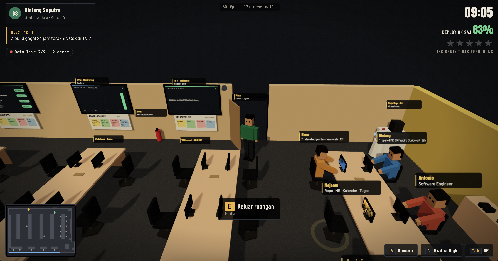
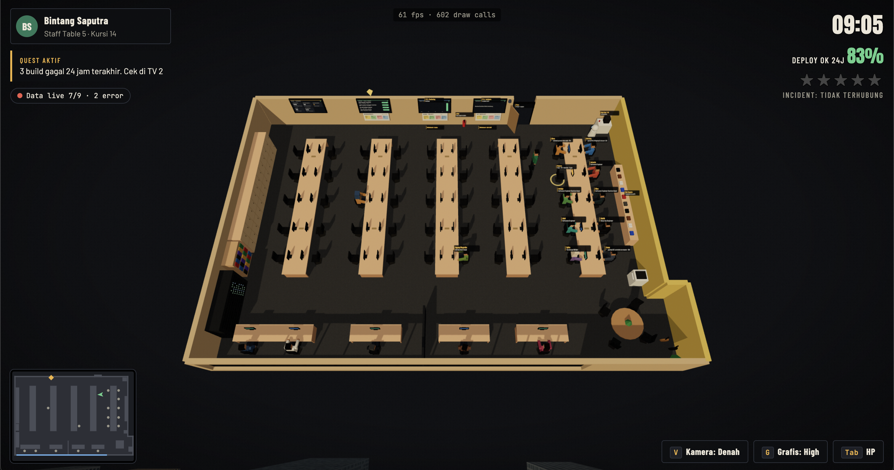

# Virtual Office 3D

A configurable, browser-based 3D virtual office built with [Three.js](https://threejs.org/). Walk around a low-poly office, interact with coworkers, explore furniture and TVs, trigger dance breaks, and play guitar — all from your browser with zero build step.




## Features

- **3D Office Environment** — Walk through a fully furnished office with desks, server racks, bookshelves, coffee station, and more
- **16+ Configurable NPCs** — Each with name, role, desk assignment, and shirt color
- **GTA-Style HUD** — Minimap, clock, quest tracker, interaction prompts, and a phone menu
- **A\* Pathfinding** — Click anywhere on the floor to walk there; NPCs navigate autonomously
- **Day/Night Cycle** — Real-time sky changes with procedural cityscape backdrop
- **Dance System** — Trigger dance breaks with NPCs, complete with music and disco lights
- **Guitar Easter Egg** — Pick up a guitar and play with Karplus-Strong string synthesis
- **Fire Incident System** — Visual fire particles, siren, and fire extinguisher mechanic
- **Beat Detection** — Upload your own MP3/WAV and the dance system syncs to its BPM
- **Config-Driven** — Edit one file (`office.config.js`) to customize everything
- **Zero Build Step** — ES modules loaded directly; just serve the folder

## Quick Start

### Option 1: npx (recommended)

```bash
git clone https://github.com/user/virtual-office-xyz.git
cd virtual-office-xyz
npx serve .
```

Open [http://localhost:3000](http://localhost:3000) in your browser.

### Option 2: Any static file server

```bash
# Python
python3 -m http.server 8000

# PHP
php -S localhost:8000

# Node (with serve installed globally)
npm install -g serve && serve .
```

### Option 3: npm scripts

```bash
npm install
npm run dev
```

> **Note:** Three.js is loaded from CDN — no `node_modules` needed for the app itself. The `npm install` only sets up the local dev server.

## Controls

| Key / Action | What it does |
|---|---|
| **WASD** or **Arrow keys** | Walk around |
| **Shift** (hold) | Run |
| **Click floor** | Walk to that spot |
| **Drag** | Rotate camera |
| **Scroll** | Zoom in/out |
| **E** | Interact with nearest object |
| **F** | Interact with second-nearest object |
| **J** | Dance break (near a dancer NPC) |
| **V** | Toggle camera (Follow / Overview) |
| **G** | Toggle graphics quality |
| **L** | Toggle floating labels |
| **T** | Cycle time of day |
| **Tab** | Open/close phone menu |
| **Escape** | Close panel / cancel route |
| **Space** | Skip travel (during phone navigation) |

## Configuration

Everything is configured in [`office.config.js`](office.config.js). Here's what you can customize:

### Basic Info

```js
title: 'My Office',
subtitle: 'Engineering Team',
tip: 'WASD to move · Click to interact',
```

### Room Layout

```js
room: {
  width: 26,    // meters
  depth: 18,
  wallHeight: 2.7,
  colors: { floor: '#3a3d45', wall: '#23262e', ceiling: '#1e2028', trim: '#f2b33d' },
},
```

### Desk Rows

```js
deskRows: [
  { id: 'T1', x: -8.6, z: -5.2, length: 6 },  // 6 seats
  { id: 'T2', x: -8.6, z: -1.8, length: 6 },
],
```

### People (NPCs)

```js
people: [
  { seat: 'T1.L0', name: 'Alice', role: 'Frontend Dev', shirt: '#3f7cc4', status: 'Working on auth module' },
  { seat: 'T1.R0', name: 'Bob',   role: 'Backend Dev',  shirt: '#2a7a5a', status: 'Reviewing PRs' },
  { seat: 'H1',    name: 'Carol', role: 'Team Lead',    shirt: '#c4573f', status: 'In a meeting' },
],
```

**Seat notation:**
- `T1.L0` = Table 1, Left side, position 0
- `T1.R2` = Table 1, Right side, position 2
- `H1` = Head desk 1

### TVs and Whiteboards

```js
tvs: [
  { id: 'tv1', x: -8, label: 'CI/CD Pipeline', content: 'All builds passing ✓' },
],
whiteboards: [
  { id: 'wb1', x: 2, title: 'Sprint Goals', notes: ['Ship auth module', 'Fix performance'] },
],
```

### Custom Panels

```js
panels: {
  coffeeStation: { title: 'Coffee Station', body: '<div class="tile"><div class="l">TODAY</div><div class="v">Arabica Blend</div></div>' },
  mydesk: { title: 'Your Workspace', body: '<div class="msg">Welcome to your desk!</div>' },
},
```

### Feature Flags

```js
enableFire: true,              // fire incident visual system
enableDayNight: true,          // real-time day/night cycle
enableCityscape: true,         // procedural city backdrop
enableGuitarEasterEgg: true,   // guitar pickup near guitars
```

## Project Structure

```
virtual-office-xyz/
├── index.html              # Entry point (CSS + HTML + bootstrap)
├── office.config.js        # ← Edit this to customize your office
├── package.json
├── LICENSE                 # MIT
├── README.md
└── src/
    ├── engine.js           # Main game loop, input, camera, UI orchestration
    ├── world.js            # 3D room construction, furniture, lighting, sky
    ├── characters.js       # Low-poly character creation & animation
    ├── navigation.js       # A* pathfinding & collision detection
    ├── audio.js            # WebAudio synthesis, guitar, beat detection
    └── utils.js            # Shared helpers (materials, meshes, sprites)
```

## How It Works

1. `index.html` loads `office.config.js` and creates a `VirtualOffice` instance
2. Three.js is loaded from CDN (v0.160.0)
3. `World` builds the room geometry, furniture, and lighting
4. `NPCManager` spawns characters at their configured desks
5. `Navigation` builds an A\* grid from obstacle AABBs (0.25m resolution)
6. The game loop handles input, pathfinding, animations, camera, and rendering at 60fps

## Extending

### Adding API Data to TVs

The TVs currently show static text from config. To show live data:

```js
// In your own wrapper script:
const game = new VirtualOffice(config)
await game.start()

// Update TV content periodically
setInterval(() => {
  game.config.tvs[0].content = `Builds: ${fetchBuildCount()}`
  game.drawTVs()
}, 30000)
```

### Adding New Furniture

Edit `office.config.js` to add furniture positions, then create the 3D geometry in `src/world.js` inside `buildFurniture()`.

### Custom NPC Behavior

The `NPCManager` in `src/characters.js` supports these modes: `sit`, `walk`, `dance`, `stand`. You can extend it with new states.

## Browser Support

- Chrome 90+ (recommended)
- Firefox 90+
- Safari 15+
- Edge 90+

WebGL 2.0 required. Works on most modern devices including laptops with integrated graphics.

## Performance Tips

- Press **G** to toggle between High and Low graphics
- Low mode disables shadows and reduces pixel ratio
- The office runs at 60fps on most devices in Low mode
- Close other GPU-heavy tabs for best performance

## License

[MIT](LICENSE) — use it for your team, your company, your hackathon, whatever you want.

## Credits

Built with [Three.js](https://threejs.org/) · Audio powered by [Web Audio API](https://developer.mozilla.org/en-US/docs/Web/API/Web_Audio_API)
